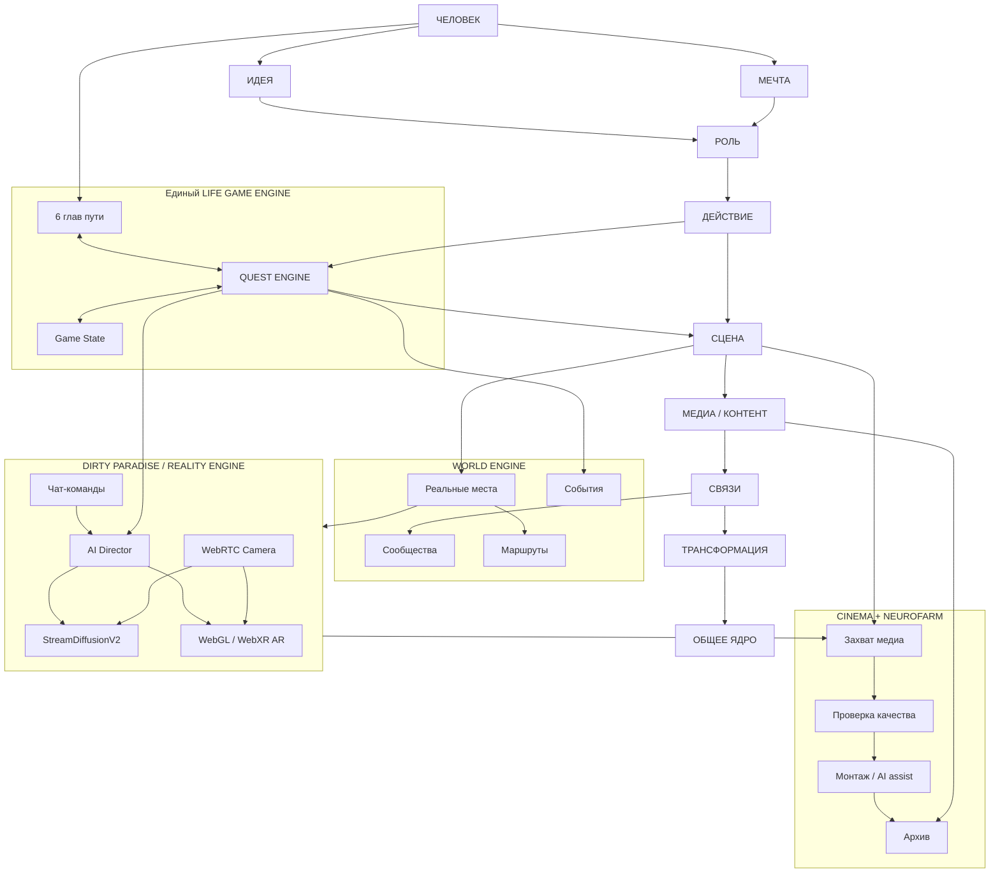

# Креативная карта TRIZNES LIFE GAME

## Схема общего игрового мира

## Путь новичка: максимум 7 шагов
1. ENTRY — человек сам выбирает начать.
2. APOLLON — короткий тёплый разговор.
3. Идея и мечта — фиксируются словами участника.
4. CHARACTER — создаётся личный профиль; незаполненное остаётся пустым.
5. Роль — выбирается на пробную сцену, без закрепления навсегда.
6. Первый квест — предлагается DIONYSUS; участник принимает/пропускает.
7. Первая сцена — результат возвращается в общую хронику по согласию.

## Объекты графа BOARDS
PERSON, IDEA, DREAM, ROLE, PLACE, COMMUNITY, EVENT, QUEST, SCENE, VIDEO, PHOTO, AUDIO, MUSIC, GENERATION, ACTION, LINK, ARTIFACT.
Связи: вдохновляет, мечтает_о, выбирает_роль, действует_в, снимается_в, создаёт, встречает, соединяет, подтверждает, входит_в_архив.
